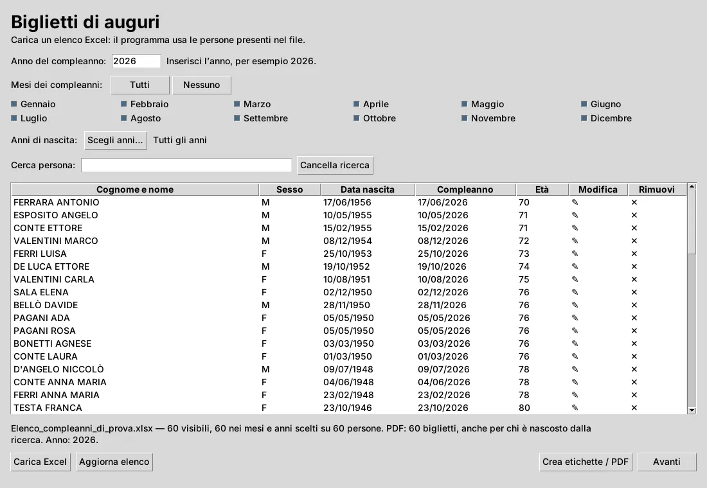
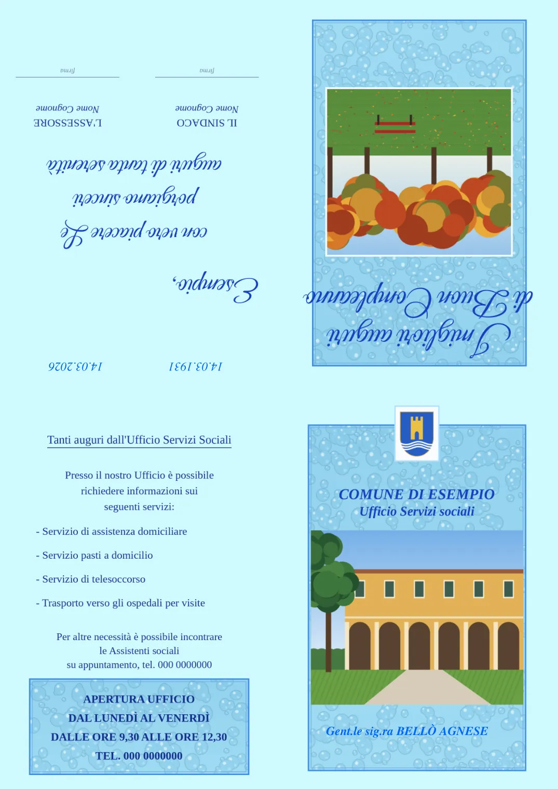
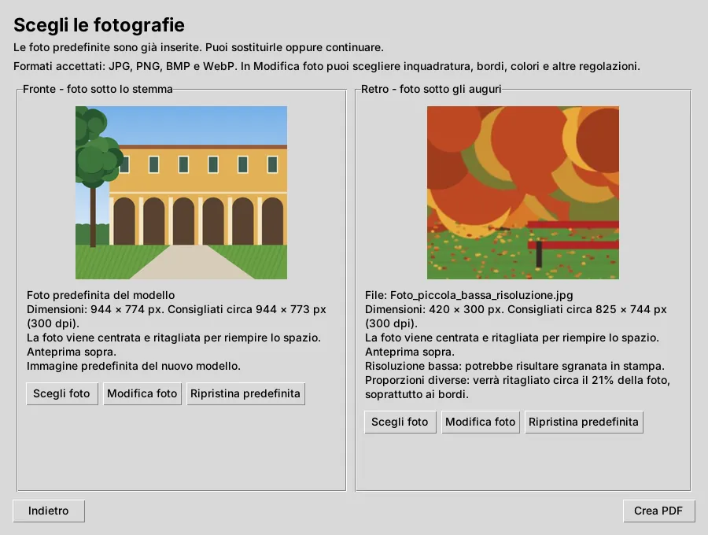
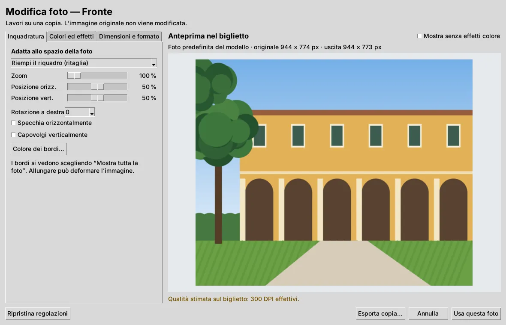
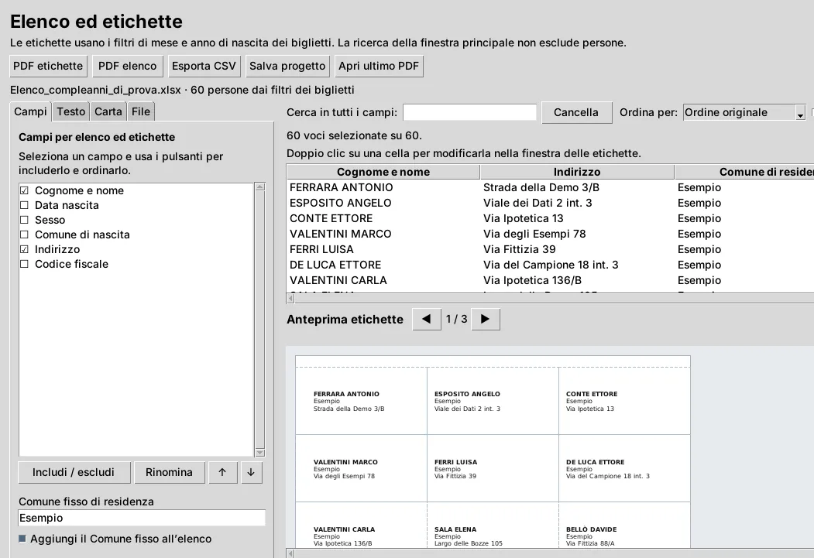

# Biglietti di auguri

Dall'elenco Excel dei residenti a un PDF con un biglietto di auguri per ogni compleanno, pronto da stampare e piegare.

> **Versione pubblica ripulita.** Codice, dati di prova, schermate e descrizioni sono stati controllati e ripuliti da dati sensibili: nomi, indirizzi, account, matricole, recapiti e credenziali sono inventati, e non ci sono riferimenti interni reali. Lo stemma dell'ente non è incluso.

| | |
|---|---|
| Categoria | Automazione documentale |
| Contesto | Stage del 4° anno al Comune di Verolanuova |
| Stato | Realizzato durante lo stage |
| Tecnologie | Python, Tkinter, Excel, PDF |
| Demo | Inclusa, con dati inventati |

## Dal caos all'ordine

**Prima:** Un elenco Excel da scorrere a mano, mese per mese.

**Dopo:** Un biglietto personalizzato per ogni compleanno, più le etichette per le buste.

## Contesto

Ogni mese l'Ufficio Servizi sociali manda un biglietto di auguri ai residenti anziani che compiono gli anni. Si partiva da un'anagrafica in Excel.

## Il problema

Scegliere le persone del mese, calcolare l'età e scrivere nome e date su ogni biglietto richiedeva tempo e lasciava spazio agli errori. Poi c'erano le buste.

## La soluzione

Un programma per Windows con Python incluso, che non chiede installazioni né Internet. Legge la tabella, filtra per mesi e anni di nascita, permette di correggere o escludere una persona senza toccare l'Excel, sistema le foto del biglietto e crea un PDF con un biglietto per pagina. Un secondo modulo prepara elenchi ed etichette.

## Come funziona

1. Elenco Excel
2. Controllo delle righe
3. Mesi e anni
4. Correzioni
5. Fotografie
6. PDF dei biglietti

## Funzioni principali

- Trova la riga delle intestazioni anche sotto un titolo
- Segnala ed esclude le righe con nome, data o sesso non validi
- Filtri per mesi del compleanno e anni di nascita, con l'età calcolata
- Ricerca, correzione ed esclusione di una persona senza modificare l'Excel
- Nome in copertina che va a capo e si rimpicciolisce se è molto lungo
- 29 febbraio indicato al 28 negli anni non bisestili, con conferma
- Editor foto: inquadratura, zoom, rotazione, colori, filtri ed esportazione
- Avvisi su risoluzione e ritaglio delle fotografie
- Elenchi, etichette, CSV e progetti salvati per le buste

## Casi inclusi nella demo

- 64 righe con due righe di titolo sopra le intestazioni
- 4 righe non valide: sesso «X», sesso mancante, data scritta come testo, nome mancante
- Una persona nata il 29 febbraio e un nome lunghissimo
- Gemelle con la stessa data, una con il sesso in minuscolo
- Una seconda tabella con le colonne in un altro ordine
- Tre foto di prova, una a bassa risoluzione per vedere gli avvisi

## Privacy

- Lavora solo sul computer: nessun dato va in rete.
- Nella demo modello del biglietto, stemma, foto, firme e persone sono inventati.

## Limiti

- Due tabelle si elaborano separatamente: chi compare in entrambe non viene unito.
- La ricerca nasconde le righe solo sullo schermo: il PDF comprende tutte le persone filtrate.
- Serve una stampa di prova su A4 al 100% prima di stampare tutto.

## Schermate

Schermate della versione dimostrativa, con dati inventati.



_Elenco caricato: 60 persone valide, 4 righe escluse e segnalate._



_Una pagina del PDF d'esempio: si stampa e si piega in quattro._



_Foto di prova piccola: il programma avvisa prima di creare il PDF._



_Editor delle foto, con l'anteprima nel riquadro del biglietto._



_Etichette per le buste, dalle stesse persone filtrate._

## Provarlo

Il pacchetto per Windows con Python incluso (nessuna installazione) è nella cartella [`demo/`](demo/): scarica le due parti ed estraile nella stessa cartella, poi avvia `AVVIA.cmd`.

Dal codice del repository (Linux, macOS o Windows con Python 3.10+):

```bash
pip install openpyxl reportlab pillow
python3 biglietti.py
```

Scrivi 2026 come anno e carica `Dati_di_prova/Elenco_compleanni_di_prova.xlsx`. Le istruzioni complete sono in `LEGGIMI_DEMO.txt`.

**Verificato:** Provato su Linux con Python 3.12: elenco con 4 righe escluse, conferma del 29 febbraio, foto con avvisi, editor, PDF di 60 biglietti e finestra delle etichette.

**Non verificato:** Non provato su un PC Windows con il Python incluso.

---

Parte del [portfolio dei progetti di stage](https://github.com/Shad272/portfolio) di Angelo Erik Scontrino.
